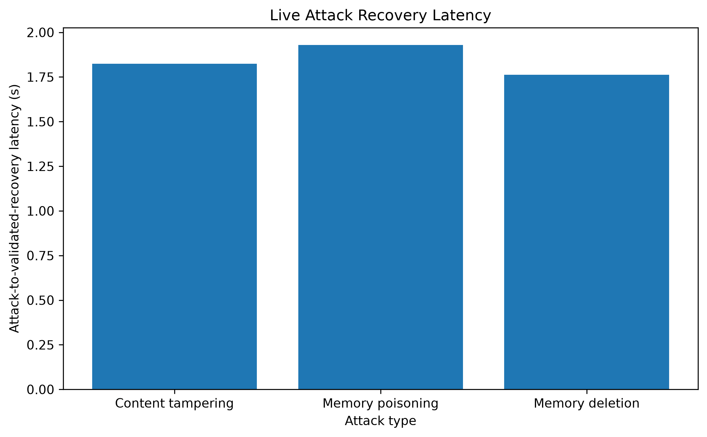
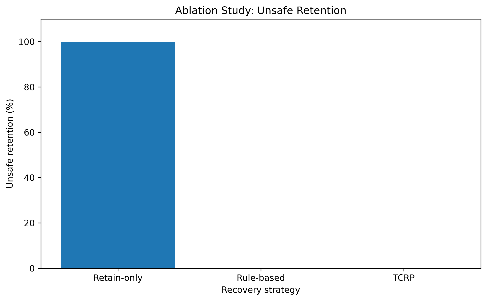
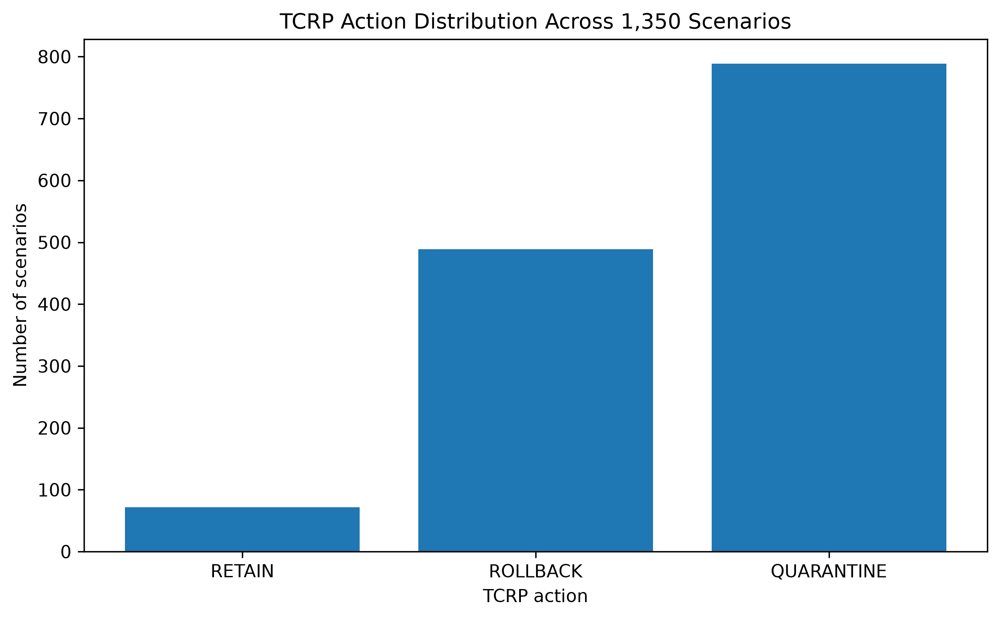
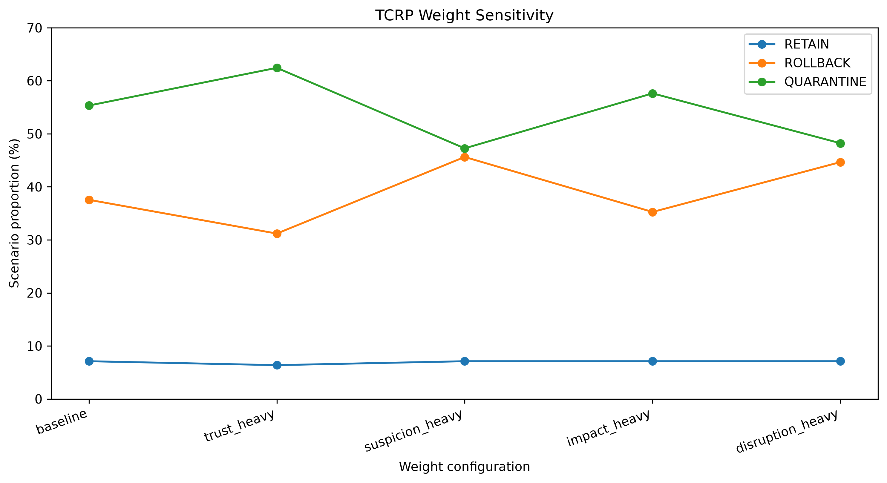

# Experimental Evaluation

## 1. Experimental Setup

The evaluation of AegisMem was designed to examine whether the proposed self-healing mechanism can detect compromise of persistent agent memory, select an appropriate recovery action through Trust-Cascaded Recovery Planning (TCRP), restore a trusted memory state, and validate the recovered state.

The experimental implementation consists of a persistent memory repository, a dependency graph, an independent security watcher, the compromise detector, the TCRP recovery planner, the recovery executor, and the validation component. The attacker operates independently of the AegisMem security layer. This separation allows the attack to modify persistent memory without directly invoking the recovery mechanism.

A controlled Kali Linux attack environment was used for live attack experiments. Three attack classes were evaluated:

1. Memory content tampering.
2. Memory poisoning.
3. Memory deletion.

For each live experiment, the attack first modifies the persistent memory state. The AegisMem watcher subsequently detects the resulting change and initiates the recovery pipeline. The recovery process selects an action, restores a trusted historical state when rollback is feasible, and validates the restored memory.

In addition to live experiments, controlled parameterized experiments were performed to evaluate TCRP behavior across different combinations of trust, suspicion, impact, dependency exposure, compromise status, and graph distance.

## 2. Evaluation Metrics

The evaluation uses the following metrics.

### 2.1 Recovery Success

A recovery is considered successful when:

- the compromised memory content is restored,
- a recovery event is generated,
- the restored version is available,
- and post-recovery validation passes.

### 2.2 Attack-to-Validated-Recovery Latency

Recovery latency is measured from the recorded attack time to the creation of the validated recovery event. This metric captures the time required for the monitoring and recovery pipeline to detect and recover from the controlled attack.

### 2.3 Unsafe Retention

Unsafe retention measures the number of scenarios in which a memory with direct compromise evidence is incorrectly assigned the RETAIN action.

### 2.4 Feasibility Compliance

Feasibility compliance measures whether the selected action belongs to the feasible action set generated by TCRP.

### 2.5 Action Distribution

The distribution of RETAIN, ROLLBACK, and QUARANTINE actions is measured to characterize TCRP's recovery behavior under different input conditions.

## 3. Live Attack Evaluation

Three controlled live attacks were evaluated using the external Kali attack path.

| Attack Type | Action | Latency | Validation | Content Restored |
|---|---|---:|---|---|
| Content tampering | ROLLBACK | 1.8243 s | PASS | Yes |
| Memory poisoning | ROLLBACK | 1.9295 s | PASS | Yes |
| Memory deletion | ROLLBACK | 1.7620 s | PASS | Yes |

All three controlled trials resulted in successful recovery. The measured mean attack-to-validated-recovery latency was 1.8386 seconds, with a median of 1.8243 seconds and an observed range of 1.7620 to 1.9295 seconds.

These results demonstrate the end-to-end behavior of the implemented recovery pipeline in the tested environment: an external attacker modifies persistent memory, the independent monitoring process detects the change, TCRP selects a recovery action, a trusted state is restored, and validation confirms the resulting state.

Because only three live trials were conducted, these measurements should be interpreted as an initial controlled demonstration rather than as a statistical estimate of system-wide reliability.

## 4. Ablation Study

An ablation study compared three recovery strategies:

- Retain-only: always retains the current memory state.
- Rule-based: performs rollback when compromise evidence is present and otherwise retains the memory.
- TCRP: determines feasible actions and selects the minimum-cost feasible recovery action.

The large-scale ablation evaluated 1,350 scenarios.

| Strategy | Unsafe Retention |
|---|---:|
| Retain-only | 675/675 (100.00%) |
| Rule-based | 0/675 (0.00%) |
| TCRP | 0/675 (0.00%) |

The retain-only strategy retained compromised states in all 675 scenarios containing direct compromise. Both the rule-based strategy and TCRP avoided unsafe retention in the tested scenarios.

For TCRP, feasibility compliance was 100%, with no selected action falling outside the feasible action set.

The result indicates that the feasibility constraints in the current TCRP implementation successfully prevent retention when direct compromise evidence is supplied. However, the experiment does not establish that TCRP is universally superior to rule-based recovery, because the rule-based strategy also achieved zero unsafe retention under these controlled conditions.

## 5. TCRP Action Distribution

Across the 1,350-scenario TCRP evaluation, the selected actions were distributed as follows:

| Action | Scenarios | Percentage |
|---|---:|---:|
| RETAIN | 72 | 5.33% |
| ROLLBACK | 489 | 36.22% |
| QUARANTINE | 789 | 58.44% |

The distribution reflects the interaction between trust, suspicion, impact, dependency exposure, compromise status, and the current feasibility constraints.

The relatively high proportion of QUARANTINE decisions should not be interpreted as evidence that quarantine is intrinsically preferable. Rather, it reflects the specific scenario distribution and cost parameters used in this controlled benchmark.

## 6. TCRP Weight Sensitivity

A sensitivity experiment examined five configurations of the TCRP cost weights:

- baseline,
- trust-heavy,
- suspicion-heavy,
- impact-heavy,
- disruption-heavy.

Each configuration was evaluated across the same 1,350 scenarios, resulting in 6,750 total TCRP evaluations.

| Configuration | RETAIN | ROLLBACK | QUARANTINE | Unsafe Retention |
|---|---:|---:|---:|---:|
| Baseline | 7.11% | 37.56% | 55.33% | 0% |
| Trust-heavy | 6.37% | 31.19% | 62.44% | 0% |
| Suspicion-heavy | 7.11% | 45.63% | 47.26% | 0% |
| Impact-heavy | 7.11% | 35.26% | 57.63% | 0% |
| Disruption-heavy | 7.11% | 44.67% | 48.22% | 0% |

No unsafe retention occurred in any of the five configurations, and no feasibility violations were observed.

The action distribution nevertheless changed as the relative weights changed. For example, the ROLLBACK proportion ranged from 31.19% under the trust-heavy configuration to 45.63% under the suspicion-heavy configuration.

This demonstrates that TCRP's action selection is sensitive to the cost-model parameters. Therefore, the current baseline weights should be regarded as engineering parameters rather than empirically established optimal values.

## 7. Discussion

The experiments provide evidence for three properties of the implemented AegisMem framework.

First, the live attack experiments demonstrate an end-to-end recovery path in which an externally generated memory modification can be followed by automated detection, TCRP planning, rollback, and validation. All three tested attack classes were successfully recovered in the controlled trials.

Second, the ablation experiments demonstrate the importance of having a recovery mechanism rather than simply retaining the latest memory state. The retain-only strategy retained compromised memories in all compromised scenarios, whereas both rule-based recovery and TCRP prevented unsafe retention in the evaluated cases.

Third, the sensitivity experiment demonstrates that TCRP is not a fixed rule table. Its selected action changes according to the relative contribution of trust, suspicion, impact, and disruption in the cost model. At the same time, the tested feasibility constraints maintained zero unsafe retention and zero feasibility violations across the evaluated configurations.

The experiments therefore support the intended role of TCRP as a trust- and cost-aware recovery planning layer. They do not, however, establish global optimality of the selected weights or universal superiority over alternative recovery planners.

## 8. Limitations

Several limitations should be considered when interpreting these results.

First, the live evaluation contains only three controlled trials, one for each attack class. The measured 3/3 recovery result therefore demonstrates successful operation in the tested cases but is not sufficient to estimate long-term reliability.

Second, the parameterized experiments are controlled synthetic scenarios rather than observations from a large production deployment. Their results characterize the behavior of the implemented planner under the specified input ranges.

Third, the TCRP cost weights were selected as engineering parameters. The sensitivity experiment shows that changing these weights changes recovery behavior, but it does not determine an empirically optimal configuration.

Fourth, the current evaluation focuses primarily on recovery correctness, feasibility, action selection, and recovery latency. A broader evaluation should additionally examine resource overhead, larger dependency graphs, concurrent attacks, recovery under missing trusted history, and behavior of a live enterprise agent before and after memory recovery.

Finally, the current results should be interpreted as an evaluation of the implemented AegisMem prototype and its controlled experimental environment rather than as evidence of production-scale deployment performance.